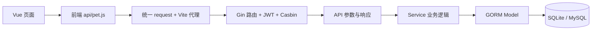

# gin-vue-admin 后端 API 编写与 Vue 页面接入：完整开发流程

本文针对当前仓库 `E:\go\pet`，用一个“宠物管理”模块，讲清楚从数据库模型、接口编写，到 Vue 列表、表单、权限和联调的完整过程。

**本文是开发教程，示例业务代码尚未写入项目。** 按步骤新增示例文件后，才能访问 `/pet/...` 接口和宠物管理页面。当前项目继续使用已经初始化的 SQLite，不需要为了编写业务接口切换 MySQL，也不需要额外启动 Redis。

- 后端：Go + Gin + GORM，目录 `server/`。
- 前端：Vue 3 + Vite + Element Plus，目录 `web/`。
- 当前前端地址：<http://127.0.0.1:8080>。
- 当前后端地址：<http://127.0.0.1:8888>。
- 后端启动配置：`server/config.local.yaml`；数据库：`server/gva.db`。
- 首次安装、初始化和每天启动：[本地运行指南](../README.local.md)。
- MySQL / Redis 配置另见：[数据库与 Redis 配置指南](mysql-redis-configuration.md)。

## 一、先看清楚开发顺序和各层职责

建议按以下顺序完成一个业务模块：

1. 确定页面功能、数据字段、接口路径和请求方式。
2. 编写 Model、请求 DTO、响应 DTO。
3. 编写 Service，完成数据查询和业务校验。
4. 编写 API，完成 HTTP 参数绑定、调用 Service、统一响应。
5. 编写 Router，并完成 `enter.go` 聚合和业务路由注册。
6. 注册数据库迁移，生成 Swagger，编译并重启后端。
7. 在 API 管理登记接口，并给对应角色分配 API 权限。
8. 编写前端 API 文件和 Vue 页面。
9. 配置菜单、角色菜单权限、按钮权限。
10. 登录后台，逐项联调和验收。



| 层 | 负责什么 | 本例位置 |
| --- | --- | --- |
| Model | 表结构、字段、软删除 | `server/model/example/pet.go` |
| Request DTO | 请求字段、绑定标签、分页条件 | `server/model/example/request/pet.go` |
| Response DTO | 明确返回数据结构 | `server/model/example/response/pet.go` |
| Service | 业务规则、GORM 查询、事务 | `server/service/example/pet.go` |
| API | `ShouldBind...`、调用 Service、返回 `{code,data,msg}` | `server/api/v1/example/pet.go` |
| Router | URL、HTTP 方法、中间件 | `server/router/example/pet.go` |
| 前端 API | 统一封装请求 | `web/src/api/pet.js` |
| Vue 页面 | 搜索、表格、分页、弹窗、交互 | `web/src/view/pet/pet-list.vue` |

Service 不接收 `gin.Context`；页面不直接拼接数据库查询；前端通过项目已有 `@/utils/request` 请求。

本例复用已有 `example` 分组，避免初学时同时增加顶层模块。正式独立业务可以建立自己的分组，但还需要在根层的 Service / API / Router 聚合结构中注册。

## 二、先约定 API 契约

### 2.1 数据字段

| 字段 | 类型 | 说明 |
| --- | --- | --- |
| `ID` | 正整数 | 主键；沿用 `global.GVA_MODEL` 的大写 JSON 字段名 |
| `name` | 字符串 | 必填，去除首尾空格后 1～50 个字符 |
| `species` | 字符串 | `dog`、`cat`、`other` 三选一 |
| `status` | 数字 | `1` 正常、`0` 停用；不能传字符串 `"0"` |
| `remark` | 字符串 | 最多 200 个字符，可以为空 |
| `CreatedAt` | 时间字符串 | 创建时间，由后端生成 |
| `UpdatedAt` | 时间字符串 | 更新时间，由后端生成 |

本例按“有权限的后台人员管理同一张宠物表”设计。实际个人宠物、商户或多租户业务，需要增加归属字段，并从后端登录信息获取当前用户 / 租户，在列表、详情、更新、删除中统一限制数据范围。JWT、Casbin 接口权限本身不会自动完成数据隔离。

### 2.2 五个接口

以下路径是后端业务路径，当前 `system.router-prefix` 为空：

| 功能 | 方法 | 后端路径 | 参数位置 |
| --- | --- | --- | --- |
| 新增 | POST | `/pet/createPet` | JSON Body：name、species、status、remark |
| 修改 | PUT | `/pet/updatePet` | JSON Body：ID + 上述全部业务字段 |
| 删除 | DELETE | `/pet/deletePet` | JSON Body：ID |
| 详情 | GET | `/pet/findPet` | Query：ID |
| 分页列表 | GET | `/pet/getPetList` | Query：page、pageSize、name、status |

本例使用 PUT 做完整表单更新；未提交的备注会按空字符串处理。如果业务需要“只更新提交的字段”，应另行设计 PATCH 请求 DTO，不能直接照搬本例。

五个接口均需要登录和角色 API 权限。新增、修改、删除额外挂操作记录中间件。

### 2.3 请求与响应示例

新增 Body：

```json
{
  "name": "小白",
  "species": "cat",
  "status": 1,
  "remark": "已完成疫苗接种"
}
```

修改 Body，要保留数字 `0` 和空备注：

```json
{
  "ID": 1,
  "name": "小白",
  "species": "cat",
  "status": 0,
  "remark": ""
}
```

新增和详情返回 `data.pet`。以下为详情响应，ID、时间仅为示意；新增结构相同，`msg` 为“新增成功”：

```json
{
  "code": 0,
  "data": {
    "pet": {
      "ID": 1,
      "CreatedAt": "2026-10-22T10:00:00+08:00",
      "UpdatedAt": "2026-10-22T10:00:00+08:00",
      "name": "小白",
      "species": "cat",
      "status": 1,
      "remark": "已完成疫苗接种"
    }
  },
  "msg": "成功"
}
```

列表返回 `data.list`，空列表使用 `[]`：

```json
{
  "code": 0,
  "data": {
    "list": [],
    "total": 0,
    "page": 1,
    "pageSize": 10
  },
  "msg": "成功"
}
```

修改、删除成功返回 `code: 0` 和提示信息；参数错误、记录不存在等业务失败返回 `code: 7`。

**本仓库的业务失败通常也是 HTTP 200。** 前端必须检查 `res.code === 0`。缺少 / 失效登录凭证会返回 HTTP 401；Casbin 拒绝访问在当前实现中返回 HTTP 200、`code: 7`、`msg: "权限不足"`，不能仅看浏览器请求的 HTTP 状态判断业务成功。

## 三、后端：逐层编写

以下完整文件可作为本例实现起点。涉及已有文件时，合并新字段、导入和注册调用，保留原有业务。

### 3.1 新建 Model

新建 `server/model/example/pet.go`：

```go
package example

import "github.com/flipped-aurora/gin-vue-admin/server/global"

type Pet struct {
	global.GVA_MODEL
	Name    string `json:"name" gorm:"size:50;not null;comment:宠物名称"`
	Species string `json:"species" gorm:"size:16;not null;comment:种类"`
	Status  int    `json:"status" gorm:"not null;comment:状态"`
	Remark  string `json:"remark" gorm:"size:200;comment:备注"`
}

func (Pet) TableName() string {
	return "biz_pets"
}
```

- `GVA_MODEL` 已包含 ID、创建时间、更新时间和软删除字段，不要再重复定义。
- 本例通过 `TableName()` 固定表名为 `biz_pets`，便于排查；这个模型不会再依靠默认命名策略添加表名前缀。
- `size` 等数据库标签不能替代业务校验，尤其 SQLite 不一定按字符串长度标签限制输入。
- 未给状态设置数据库 `default:1`，避免创建时显式 `0` 被默认值逻辑干扰。

### 3.2 新建请求 DTO

新建 `server/model/example/request/pet.go`：

```go
package request

import commonReq "github.com/flipped-aurora/gin-vue-admin/server/model/common/request"

type PetInput struct {
	Name    string `json:"name" binding:"required,max=50"`
	Species string `json:"species" binding:"required,oneof=dog cat other"`
	Status  *int   `json:"status" binding:"required,oneof=0 1"`
	Remark  string `json:"remark" binding:"max=200"`
}

type PetUpdate struct {
	PetInput
	ID uint `json:"ID" binding:"required,gt=0"`
}

type PetID struct {
	ID uint `json:"ID" form:"ID" binding:"required,gt=0"`
}

type PetSearch struct {
	commonReq.PageInfo
	Name   string `json:"name" form:"name" binding:"max=50"`
	Status *int   `json:"status" form:"status" binding:"omitempty,oneof=0 1"`
}
```

`json` 用于 JSON Body，`form` 用于 Query 等表单绑定。详情使用 `?ID=1`，不是 `?id=1`。

`status` 使用 `*int`：未传是 `nil`，明确传入 `0` 是指向 0 的指针。这样可以区分“没有选择状态”和“选择了停用”。如果直接使用 `int` 加 `required`，合法的零值也可能被当成缺失。

分页复用 `PageInfo.Paginate()`：页码不大于 0 时改为 1，每页数量不大于 0 时改为 10，超过 100 时限制为 100。

### 3.3 新建响应 DTO

新建 `server/model/example/response/pet.go`：

```go
package response

import "github.com/flipped-aurora/gin-vue-admin/server/model/example"

type PetDetail struct {
	Pet example.Pet `json:"pet"`
}
```

这样新增和详情都能保持 `data.pet`，Swagger 也可以引用同一个结构。以后 Model 增加内部字段时，可将这里改成明确列出公开字段的 DTO，避免直接返回不该展示的数据。

### 3.4 新建 Service

新建 `server/service/example/pet.go`：

```go
package example

import (
	"errors"
	"fmt"
	"strings"
	"unicode/utf8"

	"github.com/flipped-aurora/gin-vue-admin/server/global"
	"github.com/flipped-aurora/gin-vue-admin/server/model/example"
	exampleReq "github.com/flipped-aurora/gin-vue-admin/server/model/example/request"
	"gorm.io/gorm"
)

type PetService struct{}

var ErrInvalidPet = errors.New("宠物参数错误")

// API 校验之外，Service 仍检查关键规则，供其他 Go 调用方复用。
func petFromInput(input exampleReq.PetInput) (example.Pet, error) {
	name := strings.TrimSpace(input.Name)
	if name == "" || utf8.RuneCountInString(name) > 50 {
		return example.Pet{}, fmt.Errorf("%w：名称应为 1～50 个字符", ErrInvalidPet)
	}
	switch input.Species {
	case "dog", "cat", "other":
	default:
		return example.Pet{}, fmt.Errorf("%w：种类不合法", ErrInvalidPet)
	}
	if input.Status == nil || (*input.Status != 0 && *input.Status != 1) {
		return example.Pet{}, fmt.Errorf("%w：状态只能为 0 或 1", ErrInvalidPet)
	}
	if utf8.RuneCountInString(input.Remark) > 200 {
		return example.Pet{}, fmt.Errorf("%w：备注不能超过 200 个字符", ErrInvalidPet)
	}
	return example.Pet{
		Name: name, Species: input.Species,
		Status: *input.Status, Remark: input.Remark,
	}, nil
}

func (s *PetService) CreatePet(input exampleReq.PetInput) (example.Pet, error) {
	pet, err := petFromInput(input)
	if err != nil {
		return pet, err
	}
	err = global.GVA_DB.Create(&pet).Error
	return pet, err
}

func (s *PetService) UpdatePet(input exampleReq.PetUpdate) error {
	if input.ID == 0 {
		return fmt.Errorf("%w：ID 必须大于 0", ErrInvalidPet)
	}
	values, err := petFromInput(input.PetInput)
	if err != nil {
		return err
	}
	var pet example.Pet
	if err := global.GVA_DB.First(&pet, input.ID).Error; err != nil {
		return err
	}
	return global.GVA_DB.Model(&pet).Updates(map[string]interface{}{
		"name":    values.Name,
		"species": values.Species,
		"status":  values.Status,
		"remark":  values.Remark,
	}).Error
}

func (s *PetService) DeletePet(id uint) error {
	if id == 0 {
		return fmt.Errorf("%w：ID 必须大于 0", ErrInvalidPet)
	}
	result := global.GVA_DB.Where("id = ?", id).Delete(&example.Pet{})
	if result.Error != nil {
		return result.Error
	}
	if result.RowsAffected == 0 {
		return gorm.ErrRecordNotFound
	}
	return nil
}

func (s *PetService) FindPet(id uint) (example.Pet, error) {
	var pet example.Pet
	if id == 0 {
		return pet, fmt.Errorf("%w：ID 必须大于 0", ErrInvalidPet)
	}
	err := global.GVA_DB.First(&pet, id).Error
	return pet, err
}

func (s *PetService) GetPetList(info *exampleReq.PetSearch) ([]example.Pet, int64, error) {
	list := make([]example.Pet, 0)
	var total int64
	db := global.GVA_DB.Model(&example.Pet{})
	if name := strings.TrimSpace(info.Name); name != "" {
		db = db.Where("name LIKE ?", "%"+name+"%")
	}
	if info.Status != nil {
		if *info.Status != 0 && *info.Status != 1 {
			return list, total, fmt.Errorf("%w：查询状态不合法", ErrInvalidPet)
		}
		db = db.Where("status = ?", *info.Status)
	}
	if err := db.Count(&total).Error; err != nil {
		return list, total, err
	}
	err := db.Scopes(info.PageInfo.Paginate()).Order("id DESC").Find(&list).Error
	return list, total, err
}
```

这里要理解的几个点：

1. 使用参数化 `Where("... ?", value)`；不要把用户输入直接拼成 SQL。
2. `Updates(struct)` 默认跳过零值。本例使用白名单 map，确保状态改为 `0`、备注改为 `""` 都会更新。
3. 不直接把客户端提交的 Model 交给 `Save`，避免越权字段写入和不期望的新增行为。
4. 更新先 `First` 检查记录是否存在；不能把“更新影响 0 行”一律解释为记录不存在，因为值没变化也可能影响 0 行。
5. `First` 查不到返回 `gorm.ErrRecordNotFound`；列表 `Find` 查不到通常只是空数组。
6. 先 Count 再分页；传入查询指针，归一化后的 page / pageSize 会回传给 API。
7. 继承 `GVA_MODEL` 后，普通 Delete 是软删除，普通查询会排除已删除记录。
8. 本例单表操作；涉及库存、账单等多表一致性时，在 Service 内使用数据库事务。需要并发状态控制时，再增加条件更新或锁策略。

### 3.5 在 Service 的 enter.go 聚合

编辑 `server/service/example/enter.go`，在已有 `ServiceGroup` 内增加 `PetService`。按当前文件结构，合并后如下：

```go
package example

type ServiceGroup struct {
	CustomerService
	AttachmentCategoryService
	FileUploadAndDownloadService
	PetService
}
```

根层 `server/service/enter.go` 已有 `ExampleServiceGroup`，本例不需要再次新增根分组。

### 3.6 新建 API

新建 `server/api/v1/example/pet.go`：

```go
package example

import (
	"errors"

	"github.com/flipped-aurora/gin-vue-admin/server/global"
	"github.com/flipped-aurora/gin-vue-admin/server/model/common/response"
	exampleReq "github.com/flipped-aurora/gin-vue-admin/server/model/example/request"
	exampleRes "github.com/flipped-aurora/gin-vue-admin/server/model/example/response"
	exampleSvc "github.com/flipped-aurora/gin-vue-admin/server/service/example"
	"github.com/gin-gonic/gin"
	"go.uber.org/zap"
	"gorm.io/gorm"
)

type PetApi struct{}

func petFailure(c *gin.Context, err error) {
	switch {
	case errors.Is(err, gorm.ErrRecordNotFound):
		response.FailWithMessage("宠物记录不存在", c)
	case errors.Is(err, exampleSvc.ErrInvalidPet):
		response.FailWithMessage(err.Error(), c)
	default:
		global.GVA_LOG.Error("宠物业务处理失败", zap.Error(err))
		response.FailWithMessage("操作失败，请稍后重试", c)
	}
}

// CreatePet 新增宠物
// @Tags Pet
// @Summary 新增宠物
// @Security ApiKeyAuth
// @Accept json
// @Produce json
// @Param data body exampleReq.PetInput true "宠物信息"
// @Success 200 {object} response.Response{data=exampleRes.PetDetail} "以 code 判断业务结果"
// @Failure 401 {object} response.Response "登录凭证无效"
// @Router /pet/createPet [post]
func (a *PetApi) CreatePet(c *gin.Context) {
	var input exampleReq.PetInput
	if err := c.ShouldBindJSON(&input); err != nil {
		response.FailWithMessage("参数错误：名称、种类、数字状态为必填项，请检查字段类型和长度", c)
		return
	}
	pet, err := petService.CreatePet(input)
	if err != nil {
		petFailure(c, err)
		return
	}
	response.OkWithDetailed(exampleRes.PetDetail{Pet: pet}, "新增成功", c)
}

// UpdatePet 修改宠物
// @Tags Pet
// @Summary 修改宠物全部业务字段
// @Security ApiKeyAuth
// @Accept json
// @Produce json
// @Param data body exampleReq.PetUpdate true "ID 和完整宠物信息"
// @Success 200 {object} response.Response "以 code 判断业务结果"
// @Failure 401 {object} response.Response "登录凭证无效"
// @Router /pet/updatePet [put]
func (a *PetApi) UpdatePet(c *gin.Context) {
	var input exampleReq.PetUpdate
	if err := c.ShouldBindJSON(&input); err != nil {
		response.FailWithMessage("参数错误：请检查 ID、必填字段、类型和长度", c)
		return
	}
	if err := petService.UpdatePet(input); err != nil {
		petFailure(c, err)
		return
	}
	response.OkWithMessage("修改成功", c)
}

// DeletePet 删除宠物
// @Tags Pet
// @Summary 软删除宠物
// @Security ApiKeyAuth
// @Accept json
// @Produce json
// @Param data body exampleReq.PetID true "宠物 ID"
// @Success 200 {object} response.Response "以 code 判断业务结果"
// @Failure 401 {object} response.Response "登录凭证无效"
// @Router /pet/deletePet [delete]
func (a *PetApi) DeletePet(c *gin.Context) {
	var input exampleReq.PetID
	if err := c.ShouldBindJSON(&input); err != nil {
		response.FailWithMessage("参数错误：ID 必须是大于 0 的整数", c)
		return
	}
	if err := petService.DeletePet(input.ID); err != nil {
		petFailure(c, err)
		return
	}
	response.OkWithMessage("删除成功", c)
}

// FindPet 查询宠物详情
// @Tags Pet
// @Summary 查询宠物详情
// @Security ApiKeyAuth
// @Produce json
// @Param ID query int true "宠物 ID"
// @Success 200 {object} response.Response{data=exampleRes.PetDetail} "以 code 判断业务结果"
// @Failure 401 {object} response.Response "登录凭证无效"
// @Router /pet/findPet [get]
func (a *PetApi) FindPet(c *gin.Context) {
	var input exampleReq.PetID
	if err := c.ShouldBindQuery(&input); err != nil {
		response.FailWithMessage("参数错误：ID 必须是大于 0 的整数", c)
		return
	}
	pet, err := petService.FindPet(input.ID)
	if err != nil {
		petFailure(c, err)
		return
	}
	response.OkWithData(exampleRes.PetDetail{Pet: pet}, c)
}

// GetPetList 查询宠物列表
// @Tags Pet
// @Summary 分页查询宠物列表
// @Security ApiKeyAuth
// @Produce json
// @Param page query int false "页码，默认 1"
// @Param pageSize query int false "每页数量，默认 10，最大 100"
// @Param name query string false "名称模糊搜索，最多 50 字符"
// @Param status query int false "状态：0 停用、1 正常"
// @Success 200 {object} response.Response{data=response.PageResult} "list 为宠物数组，以 code 判断业务结果"
// @Failure 401 {object} response.Response "登录凭证无效"
// @Router /pet/getPetList [get]
func (a *PetApi) GetPetList(c *gin.Context) {
	var input exampleReq.PetSearch
	if err := c.ShouldBindQuery(&input); err != nil {
		response.FailWithMessage("查询参数错误，请检查分页、名称长度和状态", c)
		return
	}
	list, total, err := petService.GetPetList(&input)
	if err != nil {
		petFailure(c, err)
		return
	}
	response.OkWithData(response.PageResult{
		List: list, Total: total,
		Page: input.Page, PageSize: input.PageSize,
	}, c)
}
```

`ShouldBindJSON` 和 `ShouldBindQuery` 返回错误后要立即 `return`；否则可能继续写库或重复响应。日志记录原始数据库错误，向页面返回可理解的提示，不直接暴露 SQL 和连接信息。

### 3.7 在 API 的 enter.go 聚合

编辑 `server/api/v1/example/enter.go`，增加 `PetApi` 和 `petService`，保留原有字段：

```go
package example

import "github.com/flipped-aurora/gin-vue-admin/server/service"

type ApiGroup struct {
	CustomerApi
	AttachmentCategoryApi
	FileUploadAndDownloadApi
	PetApi
}

var (
	customerService              = service.ServiceGroupApp.ExampleServiceGroup.CustomerService
	attachmentCategoryService    = service.ServiceGroupApp.ExampleServiceGroup.AttachmentCategoryService
	fileUploadAndDownloadService = service.ServiceGroupApp.ExampleServiceGroup.FileUploadAndDownloadService
	petService                   = service.ServiceGroupApp.ExampleServiceGroup.PetService
)
```

API 通过统一 `ServiceGroupApp` 访问 Service，不需要自己创建新的全局数据库连接。

### 3.8 新建 Router

新建 `server/router/example/pet.go`：

```go
package example

import (
	"github.com/flipped-aurora/gin-vue-admin/server/middleware"
	"github.com/gin-gonic/gin"
)

type PetRouter struct{}

func (r *PetRouter) InitPetRouter(privateGroup *gin.RouterGroup) {
	petWrite := privateGroup.Group("pet").Use(middleware.OperationRecord())
	petRead := privateGroup.Group("pet")

	petWrite.POST("createPet", petApi.CreatePet)
	petWrite.PUT("updatePet", petApi.UpdatePet)
	petWrite.DELETE("deletePet", petApi.DeletePet)
	petRead.GET("findPet", petApi.FindPet)
	petRead.GET("getPetList", petApi.GetPetList)
}
```

`petRead` 虽然不记录写操作日志，仍然继承 `privateGroup` 上的 JWT 和 Casbin。不要将“读取接口”误认为“无需登录接口”。

### 3.9 在 Router 的 enter.go 聚合

编辑 `server/router/example/enter.go`：

```go
package example

import api "github.com/flipped-aurora/gin-vue-admin/server/api/v1"

type RouterGroup struct {
	CustomerRouter
	AttachmentCategoryRouter
	FileUploadAndDownloadRouter
	PetRouter
}

var (
	exaCustomerApi              = api.ApiGroupApp.ExampleApiGroup.CustomerApi
	attachmentCategoryApi       = api.ApiGroupApp.ExampleApiGroup.AttachmentCategoryApi
	exaFileUploadAndDownloadApi = api.ApiGroupApp.ExampleApiGroup.FileUploadAndDownloadApi
	petApi                      = api.ApiGroupApp.ExampleApiGroup.PetApi
)
```

### 3.10 调用业务路由初始化

编辑 `server/initialize/router_biz.go`。当前只有占位逻辑，合并后如下：

```go
package initialize

import (
	"github.com/flipped-aurora/gin-vue-admin/server/router"
	"github.com/gin-gonic/gin"
)

func holder(routers ...*gin.RouterGroup) {
	_ = routers
	_ = router.RouterGroupApp
}

func initBizRouter(routers ...*gin.RouterGroup) {
	privateGroup := routers[0]
	publicGroup := routers[1]

	holder(publicGroup, privateGroup)
	router.RouterGroupApp.Example.InitPetRouter(privateGroup)
}
```

`server/initialize/router.go` 已经调用 `initBizRouter`。本例只在业务入口注册一次，不再在主路由文件重复注册，否则 Gin 会因重复方法 / 路径而报错。

### 3.11 注册业务表迁移

编辑 `server/initialize/gorm_biz.go`：

```go
package initialize

import (
	"github.com/flipped-aurora/gin-vue-admin/server/global"
	"github.com/flipped-aurora/gin-vue-admin/server/model/example"
)

func bizModel() error {
	db := global.GVA_DB
	err := db.AutoMigrate(&example.Pet{})
	if err != nil {
		return err
	}
	return nil
}
```

如果这个文件已经注册其他模型，把 `&example.Pet{}` 追加到参数中，不要删除它们。

仅定义 Model 不会自动创建表。当前本地配置需保持 `system.disable-auto-migrate: false`，编译并重启后端后，启动流程才会执行这里的迁移。若关闭了自动迁移，应执行项目约定的数据库迁移流程；不要重新初始化已有数据库来“补表”。

本例新增独立表，兼容当前 SQLite；切换 MySQL 时业务分层和接口契约仍可复用，但应另外验证数据库约束、字符集、索引和 SQL 差异。

### 3.12 生成 Swagger、编译和重启

Swagger 注释只生成说明，不能代替路由注册，也不会自动授予角色权限。

在 `server/` 目录生成文档。如果没安装 `swag`，先安装与当前依赖匹配的版本；已有命令时跳过安装行：

```powershell
cd E:\go\pet\server
$env:GOSUMDB = 'sum.golang.org'
go install github.com/swaggo/swag/cmd/swag@v1.16.4
if ($LASTEXITCODE -ne 0) { throw 'swag 安装失败。' }
swag init
if ($LASTEXITCODE -ne 0) { throw 'Swagger 生成失败，请检查注释和类型引用。' }
```

如果 `swag` 找不到，检查 `go env GOBIN` 和 `go env GOPATH`。`GOBIN` 未自定义时，通常在 `GOPATH\bin\swag.exe`；把对应目录加入 PATH，或使用实际完整路径调用。

生成结果在 `server/docs/`。使用 `gofmt` 格式化新增和修改的 Go 文件，再停止旧后端、重新编译和启动，完整命令见本文第七节。访问 <http://127.0.0.1:8888/swagger/index.html> 检查 Pet 分组和五个接口。

## 四、登记 API 并配置角色权限

后端编译成功、Swagger 有接口，不代表当前角色已经允许调用。

1. 用有系统管理权限的账号登录后台。
2. 打开 API 管理；可同步后端路由后检查新增项，也可以手动新增这五条接口。
3. API 分组可填写“宠物管理”，描述填写具体用途。
4. 路径和请求方法必须与第二节表格完全一致，特别注意 PUT / POST / DELETE 的区别。
5. 打开角色管理，为实际使用的角色分配这五条 API 权限并保存。
6. 测试只读角色时，只分配列表和详情；写接口应被后端拒绝。

当前配置下，API 权限路径填写 `/pet/createPet` 等业务路径，**不带前端代理前缀 `/api`**。Casbin 使用 HTTP 方法和业务路径进行匹配；配置了后端 `router-prefix` 时，本仓库的 Casbin 中间件会剥离该前缀再匹配。

API 管理是权限元数据，Gin Router 才负责实际处理请求。只在 API 管理里新增一行，不会凭空生成 Go 接口。

不要通过把业务接口放进 `PublicGroup` 来解决“权限不足”。应核对当前登录角色、路径、方法和已保存的角色 API 授权。

## 五、前端：API 封装与完整 Vue 页面

### 5.1 新建前端 API 文件

新建 `web/src/api/pet.js`：

```javascript
import service from '@/utils/request'

export const createPet = (data) => {
  return service({ url: '/pet/createPet', method: 'post', data })
}

export const updatePet = (data) => {
  return service({ url: '/pet/updatePet', method: 'put', data })
}

export const deletePet = (data) => {
  return service({ url: '/pet/deletePet', method: 'delete', data })
}

export const findPet = (params) => {
  return service({ url: '/pet/findPet', method: 'get', params })
}

export const getPetList = (params) => {
  return service({ url: '/pet/getPetList', method: 'get', params })
}
```

GET 查询使用 `params`；JSON 请求使用 `data`。DELETE 的参数位置并没有统一硬性规定，本例前后端明确约定使用 JSON Body，所以这里也使用 `data`。

本地请求路径关系为：

```text
页面调用：      getPetList({ page: 1, pageSize: 10 })
API 文件 URL： /pet/getPetList
浏览器请求：   http://127.0.0.1:8080/api/pet/getPetList?page=1&pageSize=10
Vite 代理后：  http://127.0.0.1:8888/pet/getPetList?page=1&pageSize=10
```

当前 `VITE_BASE_API=/api`，Vite 会去掉这个代理前缀。API 文件不要再手工加 `/api`，也不要写死 `http://127.0.0.1:8888`。以后修改后端 `router-prefix` 时，要一起核对代理重写规则。

`@/utils/request` 已负责 token、通用加载和错误处理。对于本例 JSON 接口，它返回的通常已经是响应体 `{code,data,msg}`：

- 列表读取 `res.data.list`，不是 `res.data.data.list`。
- 详情读取 `res.data.pet`。
- 业务失败可能仍然 resolve，必须先判断 `res.code === 0`。
- HTTP / 网络失败走 catch；用 finally 释放页面自身的 loading，避免一直转圈。
- 通用层已经提示错误，页面不重复弹同一条错误消息。

### 5.2 新建 Vue 页面

新建目录 `web/src/view/pet/`，再新建 `pet-list.vue`。以下页面包含搜索、分页、新增、详情回填、编辑、删除确认和按钮权限。

```vue
<template>
  <div>
    <div class="gva-search-box">
      <el-form :inline="true" :model="searchInfo" @submit.prevent="onSearch">
        <el-form-item label="宠物名称">
          <el-input
            v-model.trim="searchInfo.name"
            placeholder="输入名称"
            maxlength="50"
            clearable
            @keyup.enter="onSearch"
          />
        </el-form-item>
        <el-form-item label="状态">
          <el-select v-model="searchInfo.status" placeholder="全部" clearable class="w-32">
            <el-option label="正常" :value="1" />
            <el-option label="停用" :value="0" />
          </el-select>
        </el-form-item>
        <el-form-item>
          <el-button type="primary" @click="onSearch">查询</el-button>
          <el-button @click="onReset">重置</el-button>
        </el-form-item>
      </el-form>
    </div>

    <div class="gva-table-box">
      <div class="gva-btn-list">
        <el-button v-if="btnAuth.create" type="primary" @click="openCreate">
          新增宠物
        </el-button>
      </div>
      <el-table v-loading="loading" :data="tableData" row-key="ID">
        <el-table-column prop="ID" label="ID" width="80" />
        <el-table-column prop="name" label="名称" min-width="140" />
        <el-table-column label="种类" width="100">
          <template #default="{ row }">
            {{ speciesLabels[row.species] || row.species }}
          </template>
        </el-table-column>
        <el-table-column label="状态" width="100">
          <template #default="{ row }">
            <el-tag :type="row.status === 1 ? 'success' : 'info'">
              {{ row.status === 1 ? '正常' : '停用' }}
            </el-tag>
          </template>
        </el-table-column>
        <el-table-column prop="remark" label="备注" min-width="160" show-overflow-tooltip />
        <el-table-column label="创建时间" width="180">
          <template #default="{ row }">{{ formatDate(row.CreatedAt) }}</template>
        </el-table-column>
        <el-table-column label="操作" width="160" fixed="right">
          <template #default="{ row }">
            <el-button v-if="btnAuth.update" type="primary" link @click="openEdit(row)">
              编辑
            </el-button>
            <el-button
              v-if="btnAuth.delete"
              type="danger"
              link
              :disabled="deleting"
              @click="removePet(row)"
            >
              删除
            </el-button>
          </template>
        </el-table-column>
      </el-table>
      <div class="gva-pagination">
        <el-pagination
          :current-page="page"
          :page-size="pageSize"
          :page-sizes="[10, 20, 50, 100]"
          :total="total"
          layout="total, sizes, prev, pager, next, jumper"
          @current-change="onPageChange"
          @size-change="onSizeChange"
        />
      </div>
    </div>

    <el-dialog
      v-model="dialogVisible"
      :title="form.ID ? '编辑宠物' : '新增宠物'"
      width="560px"
      :close-on-click-modal="false"
      :close-on-press-escape="!saving"
      :show-close="!saving"
      destroy-on-close
    >
      <el-form ref="formRef" :model="form" :rules="rules" label-width="80px">
        <el-form-item label="名称" prop="name">
          <el-input v-model.trim="form.name" maxlength="50" show-word-limit />
        </el-form-item>
        <el-form-item label="种类" prop="species">
          <el-select v-model="form.species" class="w-full">
            <el-option label="狗" value="dog" />
            <el-option label="猫" value="cat" />
            <el-option label="其他" value="other" />
          </el-select>
        </el-form-item>
        <el-form-item label="状态" prop="status">
          <el-radio-group v-model="form.status">
            <el-radio :value="1">正常</el-radio>
            <el-radio :value="0">停用</el-radio>
          </el-radio-group>
        </el-form-item>
        <el-form-item label="备注" prop="remark">
          <el-input
            v-model="form.remark"
            type="textarea"
            :rows="3"
            maxlength="200"
            show-word-limit
          />
        </el-form-item>
      </el-form>
      <template #footer>
        <el-button :disabled="saving" @click="dialogVisible = false">取消</el-button>
        <el-button type="primary" :loading="saving" @click="submitForm">保存</el-button>
      </template>
    </el-dialog>
  </div>
</template>

<script setup>
import { nextTick, onMounted, reactive, ref } from 'vue'
import { ElMessage, ElMessageBox } from 'element-plus'
import { createPet, updatePet, deletePet, findPet, getPetList } from '@/api/pet'
import { formatDate } from '@/utils/format'
import { useBtnAuth } from '@/utils/btnAuth'

defineOptions({ name: 'PetList' })

const btnAuth = useBtnAuth()
const speciesLabels = { dog: '狗', cat: '猫', other: '其他' }
const searchInfo = reactive({ name: '', status: undefined })
const tableData = ref([])
const page = ref(1)
const pageSize = ref(10)
const total = ref(0)
const loading = ref(false)
const saving = ref(false)
const deleting = ref(false)
const dialogVisible = ref(false)
const formRef = ref()
const form = reactive({ ID: 0, name: '', species: 'cat', status: 1, remark: '' })
const rules = {
  name: [
    { required: true, whitespace: true, message: '请输入名称', trigger: 'blur' },
    { max: 50, message: '名称不能超过 50 个字符', trigger: 'blur' }
  ],
  species: [{ required: true, message: '请选择种类', trigger: 'change' }],
  status: [{ required: true, type: 'number', message: '请选择状态', trigger: 'change' }],
  remark: [{ max: 200, message: '备注不能超过 200 个字符', trigger: 'blur' }]
}

// 连续切换搜索条件时，只用最后一次列表请求更新页面。
let listRequest = 0
const getTableData = async () => {
  const currentRequest = ++listRequest
  loading.value = true
  const params = {
    page: page.value,
    pageSize: pageSize.value,
    name: searchInfo.name.trim()
  }
  const status = searchInfo.status
  if (status !== undefined && status !== null && status !== '') {
    params.status = status
  }
  try {
    const res = await getPetList(params)
    if (currentRequest !== listRequest || res.code !== 0) return
    tableData.value = res.data.list
    total.value = res.data.total
    page.value = res.data.page
    pageSize.value = res.data.pageSize
  } catch (error) {
    // 通用请求层提示错误；此处记录上下文并释放本地 loading。
    console.error('宠物列表请求失败', error)
  } finally {
    if (currentRequest === listRequest) loading.value = false
  }
}

const onSearch = () => {
  page.value = 1
  getTableData()
}

const onReset = () => {
  searchInfo.name = ''
  searchInfo.status = undefined
  onSearch()
}

const onPageChange = (value) => {
  if (page.value === value) return
  page.value = value
  getTableData()
}

const onSizeChange = (value) => {
  pageSize.value = value
  page.value = 1
  getTableData()
}

const openCreate = async () => {
  Object.assign(form, { ID: 0, name: '', species: 'cat', status: 1, remark: '' })
  dialogVisible.value = true
  await nextTick()
  formRef.value?.clearValidate()
}

const openEdit = async (row) => {
  try {
    const res = await findPet({ ID: row.ID })
    if (res.code !== 0) return
    const pet = res.data.pet
    Object.assign(form, {
      ID: pet.ID,
      name: pet.name,
      species: pet.species,
      status: pet.status,
      remark: pet.remark
    })
    dialogVisible.value = true
    await nextTick()
    formRef.value?.clearValidate()
  } catch (error) {
    console.error('宠物详情请求失败', error)
  }
}

const submitForm = async () => {
  if (saving.value || !formRef.value) return
  saving.value = true
  try {
    const valid = await formRef.value.validate().catch(() => false)
    if (!valid) return
    const data = {
      name: form.name.trim(),
      species: form.species,
      status: form.status,
      remark: form.remark
    }
    const res = form.ID
      ? await updatePet({ ...data, ID: form.ID })
      : await createPet(data)
    if (res.code !== 0) return
    ElMessage.success(res.msg || '保存成功')
    dialogVisible.value = false
    await getTableData()
  } catch (error) {
    console.error('宠物保存请求失败', error)
  } finally {
    saving.value = false
  }
}

const removePet = async (row) => {
  if (deleting.value) return
  try {
    await ElMessageBox.confirm(`确定删除“${row.name}”吗？`, '删除确认', {
      type: 'warning',
      confirmButtonText: '删除',
      cancelButtonText: '取消'
    })
  } catch {
    return // 取消和关闭确认框都不发送删除请求。
  }
  deleting.value = true
  try {
    const res = await deletePet({ ID: row.ID })
    if (res.code !== 0) return
    ElMessage.success(res.msg || '删除成功')
    if (tableData.value.length === 1 && page.value > 1) page.value -= 1
    await getTableData()
  } catch (error) {
    console.error('宠物删除请求失败', error)
  } finally {
    deleting.value = false
  }
}

onMounted(getTableData)
</script>
```

### 5.3 理解页面如何工作

| 用户动作 | 页面执行 | 对应接口 |
| --- | --- | --- |
| 打开页面 | `onMounted → getTableData` | GET 列表 |
| 点击查询 / 重置 | 页码归 1，再查询 | GET 列表 |
| 切换分页 | 更新 page / pageSize，再查询 | GET 列表 |
| 点击新增 | 重置独立表单，打开弹窗 | 暂不请求 |
| 编辑已有行 | 用 ID 获取详情，再复制允许编辑的字段 | GET 详情 |
| 保存新增 | 前端校验，提交业务字段 | POST 新增 |
| 保存修改 | 前端校验，提交 ID 和业务字段 | PUT 修改 |
| 确认删除 | 提交 ID，成功后刷新列表 | DELETE 删除 |

页面使用独立表单对象，不直接把 `row` 当作表单；否则用户点“取消”，表格也可能已经被双向绑定修改。

`el-option` / `el-radio` 的状态使用 `:value="0"` 和 `:value="1"`，确保提交数字；搜索条件不能写成 `if (status)`，否则停用状态 `0` 会被漏掉。

页面本地列表、弹窗和表单使用 `ref` / `reactive` 即可。多个页面需要共享的状态再放入 Pinia，不必为每张 CRUD 页面都新增全局 store。

## 六、菜单、页面与按钮权限接入

### 6.1 新建动态菜单

页面文件存在后，进入系统的菜单管理，新增一条菜单。放在现有布局菜单下面，参考填写：

| 配置项 | 本例填写 | 说明 |
| --- | --- | --- |
| 菜单标题 | 宠物管理 | 用户看到的名称 |
| 路由名称 / routeName | `PetList` | 全局唯一，与页面组件名称保持一致 |
| 路由路径 / path | `pet-list` | 作为所选父级下的相对路径，避免和已有路径重复 |
| 页面组件 / component | `view/pet/pet-list.vue` | 与文件位置严格对应 |
| 是否隐藏 | 否 | 需要在侧边栏显示时 |

组件字段不要填 `@/view/...`、`src/view/...` 或绝对磁盘路径。当前项目通过 `web/src/utils/asyncRouter.js` 的 glob 加载页面，正确值为 **`view/pet/pet-list.vue`**。

普通后台业务页走动态菜单，不需要同时在 `web/src/router/index.js` 手工加一份静态路由。

### 6.2 给角色分配菜单

进入角色管理，为使用该功能的角色勾选“宠物管理”菜单并保存。菜单授权决定用户能否看到并进入该页面，API 授权决定请求能否通过后端。

如果菜单已经配置，当前登录会话仍看不到，退出后重新登录，重新加载菜单和权限。

### 6.3 配置可控按钮

上面的页面使用 `useBtnAuth()` 获取 `route.meta.btns`，需要配置三个按钮标识：

| 按钮名称 | 标识 / name | 页面判断 |
| --- | --- | --- |
| 新增 | `create` | `btnAuth.create` |
| 编辑 | `update` | `btnAuth.update` |
| 删除 | `delete` | `btnAuth.delete` |

1. 在菜单管理中找到“宠物管理”的“可控按钮配置”，新增这三个标识。
2. 在角色管理的菜单权限中，对该菜单执行“分配按钮”，给角色勾选允许使用的按钮。
3. 保存后重新登录，检查新增、编辑、删除按钮是否符合授权。

没有配置或没有分配的按钮会隐藏，这是本例 `v-if` 的正常结果。后端仍必须保留 Casbin 检查，隐藏按钮不能阻止用户自己构造 HTTP 请求。

### 6.4 三类权限分别检查

| 权限 | 控制内容 | 缺少时常见现象 |
| --- | --- | --- |
| 角色菜单权限 | 页面入口 | 侧栏没有菜单，或动态路由未加载 |
| 菜单按钮权限 | 页面上的操作按钮 | 有页面，没有新增 / 编辑 / 删除按钮 |
| 角色 API 权限 | 后端是否接受请求 | 页面能打开，但请求返回“权限不足” |

除此之外，用户归属 / 租户数据权限需要在 Service 查询条件中实现，不能用这三类配置替代。

## 七、第一次启动与每次修改后的命令

下面适用于 Windows PowerShell，两个终端分别运行后端和前端。**编写本教程文档不会自动执行这些命令。**

### 7.1 全新环境的第一次启动

先按 [本地运行指南](../README.local.md) 准备完整的 SQLite 本地配置；该文档包含配置复制、空库初始化和首次登录步骤。不要只复制几条数据库字段来替代完整配置文件。

后端终端，在配置准备完成后运行：

```powershell
cd E:\go\pet\server
$env:GOSUMDB = 'sum.golang.org'
go mod download
if ($LASTEXITCODE -ne 0) { throw 'Go 依赖下载失败。' }
go build -o gva.local.exe .
if ($LASTEXITCODE -ne 0) { throw '后端编译失败，本次不启动。' }
.\gva.local.exe -c config.local.yaml
```

前端终端：

```powershell
cd E:\go\pet\web
npm.cmd ci --no-audit --no-fund
if ($LASTEXITCODE -ne 0) { throw '前端依赖安装失败。' }
npm.cmd run serve -- --strictPort
```

全新空库才执行初始化。**本机 SQLite 已经初始化，无需重复初始化或删除 `gva.db`。** 本机基础 Go 的工具链校验需要临时设置 `GOSUMDB`，这里仅修改当前终端环境变量。

### 7.2 每次修改 Go 后端代码

先在原后端终端按 `Ctrl+C` 停止进程，确保旧程序已退出，避免 Windows 下可执行文件被占用。若修改了 Swagger 注释，先执行第三节的 `swag init`，再构建：

```powershell
cd E:\go\pet\server
$env:GOSUMDB = 'sum.golang.org'
go build -o gva.local.exe .
if ($LASTEXITCODE -ne 0) { throw '后端编译失败，请修复错误后再启动。' }
.\gva.local.exe -c config.local.yaml
```

普通 `go build` / 可执行文件运行方式没有自动热重载。新增 Router、API、Service、Model 或修改它们，都需要重新编译并启动；只重新运行旧 exe 不会包含新代码。

### 7.3 每次修改 Vue / JS / 样式

保持开发服务运行：

```powershell
cd E:\go\pet\web
npm.cmd run serve -- --strictPort
```

服务已经运行时，保存 `.vue`、普通 JS、样式文件通常由 Vite 热更新，无需每次重复执行启动命令。首次新增页面后若动态菜单仍未刷新，重新登录；模块未被识别时再重启 Vite。

### 7.4 不同变更对应的处理

| 修改内容 | 需要做什么 |
| --- | --- |
| 后端业务 Go 文件 | 停止旧进程，重新编译并启动 |
| Swagger 注释 | `swag init`，再编译启动 |
| Model / 迁移注册 | 编译启动；确认自动迁移开关和实际数据库文件 |
| `config.local.yaml` | 使用同一个 `-c` 配置重启后端；端口变化时同步前端代理 |
| 普通 Vue / JS / CSS | 保存并检查热更新 |
| 前端 `.env` / Vite 配置 | 停止并重启前端 |
| 前端 package / lock 依赖 | 按仓库依赖变更流程更新依赖；锁文件一致时可用 `npm.cmd ci`，然后重启 |
| 菜单 / 角色 / 按钮授权 | 保存配置，重新登录，检查实际当前角色 |
| 只修改本文 Markdown | 无需重启项目 |

生产部署需要另外执行前端构建、后端构建和部署验证；不能用“开发服务器能打开”代替部署验收。

## 八、接口与页面联调步骤

### 8.1 先检查后端是否可用

访问 <http://127.0.0.1:8888/health>，再看后端启动日志是否有迁移错误和宠物路由注册信息。

若提示表不存在，依次检查：

1. 启动命令是否显式使用 `-c config.local.yaml`。
2. 工作目录是否为 `E:\go\pet\server`，是否打开了预期的 SQLite 文件。
3. `gorm_biz.go` 是否包含 `&example.Pet{}`。
4. `system.disable-auto-migrate` 是否为 `false`。
5. 本次修改后是否成功编译，并启动了新的 exe。

不要遇到表不存在就删除数据库。应先定位配置、迁移注册和启动程序。

### 8.2 用 Swagger 调试单个接口

1. 先登录后台，取得当前有效的 `x-token`，并确认该角色已有 API 权限。
2. 打开 <http://127.0.0.1:8888/swagger/index.html>。
3. 在 Authorize 中给 `ApiKeyAuth` 填写 token 原值；本仓库使用 `x-token`，不额外拼 `Bearer `。
4. 调用新增，再用返回的 ID 调用详情、更新、列表和删除。
5. 同时检查 HTTP 状态、响应 `code`、`msg` 和后端日志。

不要把含 token 的截图或请求导出文件提交到仓库。

### 8.3 PowerShell 完整请求示例

以下脚本在你已实现本例、已登录且已授予权限后手动执行。它会新增一条联调记录、修改、查询，再删除刚创建的记录；不要替换成真实业务数据的 ID。

token 可从浏览器开发者工具 Network 中已经成功的后台请求的 `x-token` 请求头取得。脚本交互读取，不写进源码文件：

```powershell
$petBase = 'http://127.0.0.1:8888'
$petToken = Read-Host '粘贴当前有效的 x-token'
$petHeaders = @{ 'x-token' = $petToken }
$petContentType = 'application/json; charset=utf-8'

# 新增；状态使用数字。
$petCreateBody = @{
    name = '接口联调临时宠物'
    species = 'cat'
    status = 1
    remark = '仅用于本例联调'
} | ConvertTo-Json
$petCreated = Invoke-RestMethod -Method Post -Uri "$petBase/pet/createPet" `
    -Headers $petHeaders -ContentType $petContentType -Body $petCreateBody
if ($petCreated.code -ne 0) { throw $petCreated.msg }
$petTestId = $petCreated.data.pet.ID
if (-not $petTestId -or $petTestId -le 0) { throw '新增响应缺少有效 ID，停止后续操作。' }

# 详情；Query 使用大写 ID。
$petDetail = Invoke-RestMethod -Method Get -Uri "$petBase/pet/findPet?ID=$petTestId" `
    -Headers $petHeaders
if ($petDetail.code -ne 0) { throw $petDetail.msg }
$petDetail.data.pet

# 修改为停用，并清空备注，验证零值更新。
$petUpdateBody = @{
    ID = $petTestId
    name = '接口联调临时宠物'
    species = 'cat'
    status = 0
    remark = ''
} | ConvertTo-Json
$petUpdated = Invoke-RestMethod -Method Put -Uri "$petBase/pet/updatePet" `
    -Headers $petHeaders -ContentType $petContentType -Body $petUpdateBody
if ($petUpdated.code -ne 0) { throw $petUpdated.msg }

# 列表；status=0 不能因为是假值而被忽略。
$petList = Invoke-RestMethod -Method Get `
    -Uri "$petBase/pet/getPetList?page=1&pageSize=10&status=0" -Headers $petHeaders
if ($petList.code -ne 0) { throw $petList.msg }
$petList.data

# 删除本次创建的测试记录。
$petDeleteBody = @{ ID = $petTestId } | ConvertTo-Json
$petDeleted = Invoke-RestMethod -Method Delete -Uri "$petBase/pet/deletePet" `
    -Headers $petHeaders -ContentType $petContentType -Body $petDeleteBody
if ($petDeleted.code -ne 0) { throw $petDeleted.msg }
Remove-Variable petToken, petHeaders
```

如果配置了后端路由前缀，直接请求后端时把它追加到 `$petBase`。这里直连 8888，不经过 Vite，所以当前环境下不带 `/api`。

### 8.4 再用页面验证请求链路

打开浏览器开发者工具 Network，进入宠物管理页面：

1. 确认列表请求是 GET，请求地址为前端 `/api/pet/getPetList`。
2. 确认请求头带 `x-token`，响应业务 `code` 为 0。
3. 确认列表使用 `data.list`，分页读取 `total`、`page`、`pageSize`。
4. 新增后检查 JSON Body 没有 ID、时间、删除标记等内部字段。
5. 编辑后检查 Body 含大写 `ID`，并且 `status` 是数字。
6. 搜索“停用”时，确认 Query 中实际包含 `status=0`。
7. 删除确认框点取消，确认 Network 中没有删除请求。
8. 断开后端或制造失败请求，确认页面 loading / saving 能恢复。

## 九、常见问题与定位方法

| 现象 | 优先检查 | 处理方向 |
| --- | --- | --- |
| 接口 404 | 方法、路径、路由初始化、当前 exe | `enter.go` 聚合后还需要 `InitPetRouter` 注册并重编译 |
| HTTP 401 | token 是否缺失 / 过期 | 重新登录，检查共享 request 是否携带 `x-token` |
| HTTP 200，但提示权限不足 | 当前角色的 API 路径和方法 | 给实际角色授予正确权限，不改成公开路由 |
| Swagger 没有新接口 | 注释和生成结果 | 在 server 执行 `swag init`，再编译启动 |
| Swagger 有接口，但调用 404 | 真实 Gin 路由 | Swagger 注释不能替代路由注册 |
| 提示 no such table / 表不存在 | 配置、数据库文件、迁移开关 | 检查 `gorm_biz.go` 和实际启动目录 |
| 更新状态 0 没生效 | 后端是否 `Updates(struct)` | 使用明确 map / Select 更新允许的零值字段 |
| 查询停用时返回全部 | 前端是否用 `if (status)` | 区分未选择和数值 0，再检查后端指针条件 |
| 详情参数绑定失败 | Query 的 ID 大小写 | 本例使用 `?ID=1`，写入请求 JSON 也用 `ID` |
| GET 收不到参数 | 前端是否把参数写成 data | 改为 params，并与 `ShouldBindQuery` 对齐 |
| 删除时后端收不到 ID | DELETE Body / Query 约定不一致 | 本例统一 JSON Body + `ShouldBindJSON` |
| 页面显示 undefined | 响应读取层级 | 使用 `res.data.list` / `res.data.pet` |
| 业务失败仍关闭弹窗 | 是否只依赖 try/catch | 先判断 `res.code === 0`，再改变成功状态 |
| 表格内容被取消编辑影响 | 表单是否直接引用 row | 建立独立表单，只复制可编辑字段 |
| 菜单不显示 | 角色菜单权限、当前会话 | 授权后重新登录 |
| 页面组件加载失败 | 菜单 component | 精确填写 `view/pet/pet-list.vue` |
| 页面有了，按钮没有 | 菜单按钮标识和角色分配 | 配置 create / update / delete，并重新登录 |
| Gin 提示重复路由 | 是否注册了两次 | 业务入口保留一次初始化调用 |
| Go 编译 undefined | 文件包名、聚合字段、变量名 | 对照 Service / API / Router 三个 enter.go |
| Go 编译 imported and not used | 导入是否只用于注释 | Go 注释不算代码使用，删除多余导入或使用真实 DTO |
| 代码改了效果没变 | 是否启动旧 exe | 确认构建成功，停止旧进程后运行新 exe |
| 删除后数据库还能看到行 | 软删除字段 | 普通删除会写 deleted_at，正常业务查询会自动过滤 |
| 删除分页最后一条后空白 | 页码是否回退 | 本例回退一页再查；复杂并发场景可按总数再修正页码 |

## 十、完成前的验收清单

实现示例后，至少手动验证以下项目；关键业务应按项目测试规范补充自动化测试：

- [ ] 正常新增、详情、修改、删除都成功，列表和总数正确。
- [ ] 空名称、纯空格、超长字段、未知 species、缺少 status、status=2 被拒绝。
- [ ] `status: 0` 可以新增 / 更新；`remark: ""` 能清空原备注。
- [ ] 列表使用 status=0 筛选有效；空结果返回 list=[]、total=0。
- [ ] page / pageSize 缺省、为 0、超过上限时，返回归一化分页值。
- [ ] ID 缺失 / 为 0 被拒绝；不存在或已删除记录有明确业务提示。
- [ ] 同样内容重复保存不会因为“影响 0 行”误报记录不存在。
- [ ] 删除是软删除，常规详情和列表无法再次读取已删除记录。
- [ ] 未登录访问失败；只读角色无法直接调用写接口。
- [ ] 菜单和按钮显示符合角色授权，API 权限独立生效。
- [ ] 查询和切换页大小会重置到第一页，最后一条删除后页码可用。
- [ ] 网络失败 / 业务失败不误报成功，loading 不会一直保留。
- [ ] Swagger 的方法、路径、参数位置和响应结构与真实代码一致。
- [ ] 如果业务存在个人 / 商户 / 租户归属，已验证跨用户访问被后端拒绝。

## 十一、文件改动清单与已有参考

按教程实现时新增 8 个业务文件：

```text
server/model/example/pet.go
server/model/example/request/pet.go
server/model/example/response/pet.go
server/service/example/pet.go
server/api/v1/example/pet.go
server/router/example/pet.go
web/src/api/pet.js
web/src/view/pet/pet-list.vue
```

修改 5 个已有业务入口，保留原有注册：

```text
server/service/example/enter.go
server/api/v1/example/enter.go
server/router/example/enter.go
server/initialize/router_biz.go
server/initialize/gorm_biz.go
```

此外按注释生成 `server/docs/` 中的 Swagger 文档，并在后台配置 API、角色、菜单和按钮。

可以对照本仓库已有实现阅读：

- 后端分层：[规则](../aiDoc/modules/backend-layer-rules.md)、[Service 示例](../aiDoc/examples/backend/service-example.md)、[API 示例](../aiDoc/examples/backend/api-example.md)。
- 现有业务：[客户 Service](../server/service/example/exa_customer.go)、[客户 Router](../server/router/example/exa_customer.go)。
- 项目基类：[GVA_MODEL](../server/global/model.go)、[分页请求](../server/model/common/request/common.go)、[统一响应](../server/model/common/response/response.go)。
- 路由与权限：[初始化入口](../server/initialize/router.go)、[JWT](../server/middleware/jwt.go)、[Casbin](../server/middleware/casbin_rbac.go)。
- 前端复用：[统一请求](../web/src/utils/request.js)、[动态组件加载](../web/src/utils/asyncRouter.js)、[按钮权限](../web/src/utils/btnAuth.js)、[客户页面](../web/src/view/example/customer/customer.vue)。
- 跨栈约定：[前后端边界](../aiDoc/frontend-backend/boundary.md)、[前端规则](../aiDoc/frontend-backend/frontend-rules.md)、[工具函数](../aiDoc/frontend-backend/frontend-utils.md)。

官方文档：

- [Gin 参数绑定与校验](https://gin-gonic.com/en/docs/examples/binding-and-validation/)
- [GORM 更新与零值](https://gorm.io/docs/update.html)
- [GORM 删除与软删除](https://gorm.io/docs/delete.html)
- [Vue 表单绑定](https://vuejs.org/guide/essentials/forms.html)
- [Vue script setup](https://vuejs.org/api/sfc-script-setup.html)

文档校验记录（2026-10-22）：11 段 Go 示例已通过语法检查，Vue 单文件示例已通过 script setup 和模板编译，2 段 JavaScript、6 段 PowerShell 已通过语法检查，JSON 示例和本地文档链接已校验。PowerShell 启动 / 请求命令未执行，也未将 Go 示例加入完整后端进行编译或接口联调。

本文已按当前仓库入口、响应封装和权限中间件核对。示例尚未作为真实业务模块落地，接口、迁移及角色授权的运行验收需在实现后按第十节完成。
